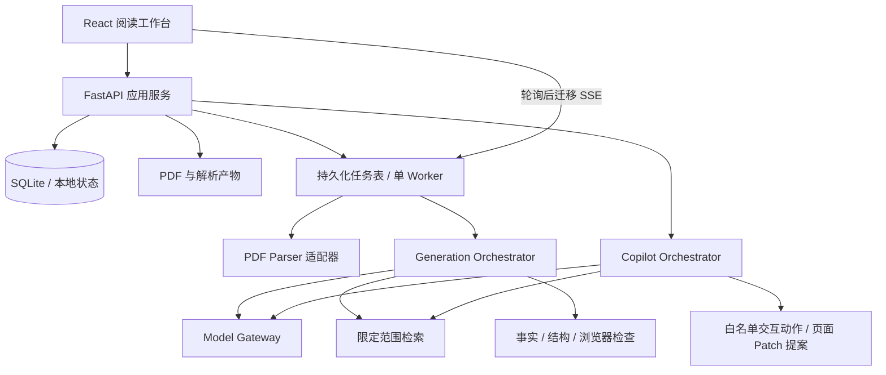

# paperMind 前后端、Agent、Skill 与模型开发方案

> 2026-10-25 实现状态更新：已接入阿里千问生成、OCR、视觉提问、真实联网和来源对照核验。本文下方保留初期方案/测试历史，不作为当前能力声明。当前运行说明见根 README，实测与未解决问题见 docs/LIVE-BOUNDARY-REPORT.md、docs/FIRST-PASS-ISSUES.md；运行契约以 backend/live_contracts.py 为准。


版本：0.1，日期：2026-10-24。基线：用户已确认的 29 项整合设计决策。

本文是开发方案，不是功能完成声明。当前可运行能力及待接入能力见第 15 节和 README。旧 Streamlit 入口 app.py、app.py.txt 已按用户要求删除，原始需求资料保留。

## 1. 工程结论

采用 React + TypeScript + Vite 的三栏阅读工作台，Python FastAPI 提供文档、生成任务、检索与 Copilot API，SQLite 保存单机数据。本地文件保存 PDF、解析产物与页面资产。第一阶段保持无账号、单机使用；访问云模型时，仅发送所需上下文，密钥只保存在后端。

Agent 层采用一个持久化编排器驱动有明确职责的工作节点。Skill 是版本化的任务规范与工具权限包，不是一个新的自主 Agent。模型负责有歧义的内容判断，确定性代码负责解析状态、引用完整性、Schema、权限、版本与交互执行。

交互讲解借鉴 pdf-to-interactive-web 的事实账本、读法选择和引用回查，但输出结构化 LessonPackage，而不是把任意生成 HTML 直接放进主应用。可持续修改、来源跟踪和跨论文复用需要稳定的节点 ID、内容版本和数据库记录。

模型供应商通过 Provider 接口替换。OpenAI 路线优先使用 Responses API 的 Structured Outputs 与 function calling；模型 ID 由配置与真实样本评测确定，不将某个产品套餐或模型名字写死进业务逻辑。Demo 默认 fixture provider，不要求 API Key，也没有真实模型或联网检索调用。

## 2. 产品不变量与首版边界

1. 首轮生成完成必须覆盖全篇核心论证，不能靠后续追问补出主线。
2. 已检查的分段可以先读；存在核心缺口时整篇保持 incomplete。
3. 知识递归与 Copilot 位于右栏，主线的滚动位置和节点身份不因侧栏切换而改变。
4. 主线按内容组织；不设置固定的“小白／中阶／高阶”人群标签。
5. 没有理解测试、测验与掌握分数。概念库是用户保存的知识层级声明。
6. 页面补充、概念库与对话偏好是三个不同的数据对象。
7. 论文主张、外部知识、教学加工必须区分；教学数值不是论文实验。
8. 用户确认后应用页面修改，保留来源并可撤回；首版不开放直接编辑正文。
9. 首轮忠实解释；外部争议评议仅在用户请求后开启。
10. 当前对话可附加其他文献，但检索和引用受显式附加范围约束。

首版开发顺序：先完成一份文档的可靠闭环，再扩展多种专业文档的质量。学术论文、白皮书和研报属于目标范围，实际解析与结构覆盖必须分别评测；算法机制演示不能成为所有文档的强制模板。

## 3. 系统结构



第一版建议采用模块化单体，一个 API 进程和一个可恢复的 Worker。任务和事件先存在 SQLite，无需先引入 Redis、Kafka、微服务或大型图数据库。在线业务扩展到多用户后再迁移 PostgreSQL 与对象存储；这是未来方案，不是本轮 Demo 依赖。

生成任务不能只放在 FastAPI BackgroundTasks 中并宣称可恢复：该机制不提供持久队列。生产开发使用 jobs 表中的状态、租约、心跳和检查点；服务重启后回收过期租约。Demo 未运行这一生成队列。

## 4. 前端精细设计

### 4.1 信息架构与状态归属

| 区域 | 职责 | 状态与恢复方式 |
| --- | --- | --- |
| 顶栏 | 当前空间、概念库入口、本地状态 | 空间级；不显示模型编排细节 |
| 左栏 | PDF 导入、文档选择、主线目录、检查入口 | document_id、active_node_id |
| 中间阅读区 | 全貌、完整主线、机制探索、公式、证据与局限 | lesson_revision、node_id、scroll_anchor、组件参数 |
| 右栏知识 | 概念解释、递归路径、上下层返回 | concept_id、layer、path、知识视图滚动位置 |
| 右栏 Copilot | 每篇连续对话、当前提问位置、附加文献、修改预览 | conversation_id、message anchors、selected region |
| 右栏个人库 | 用户保存的知识层级及可撤销偏好 | library item 与 memory 分开存储 |
| 原文视图 | PDF 页面、引用高亮、返回讲解位置 | physical_page、bbox、原阅读锚点 |

推荐正式前端拆分 reader / knowledge / copilot / sources / library 五个 feature 模块；当前 Demo 的 App.tsx 为初步集成页面，正式开发前拆分，不把它当长期组件结构。

页面正文使用受控 Block Renderer：paragraph、formula、mechanism、evidence table、limitations、source link。公式用 KaTeX 渲染，图表与机制用受控 SVG/Canvas。PDF.js 提供正式 PDF 页面、文字层与区域选择；Demo 对上传文件使用浏览器 PDF 查看器，未实现区域框选。

服务端状态正式版建议用 TanStack Query 管理缓存、重试和失效；阅读与侧栏状态用局部 reducer/context 即可。Demo 仅使用 React state 与 fetch，避免为了初步验证引入额外状态框架。

### 4.2 交互协议

- 选中文字：发送原始片段、node_id、block_id 与来源锚点，不只发送用户看到的缩写。
- 点击公式：发送 formula_id、LaTeX、符号表与上下文锚点。
- 框选图表：PDF.js 坐标转换到页内归一化 bbox，发送 document_id、page、bbox、crop_asset_id；后端校验边界与所属文档。
- 切换章节：更新当前提问上下文，不重开对话、不重写旧消息锚点。
- 切换知识与对话：分别保存视图状态；阅读正文不卸载。
- 模型操作演示：仅接收白名单 action，经参数校验后执行；操作前状态进入本地撤回栈。不会自动应用正文修改。
- 页面修改：提案预览 → 用户确认 → 乐观并发校验 → 原子提交 → 可撤回。
- 窄屏：主线单列，目录与右栏为可收起面板；键盘焦点、关闭入口和滚动范围需要端到端检查。

### 4.3 视觉方向

阅读场景是研究者在日常办公光线下持续阅读，采用明亮纸面、低饱和蓝灰色导航和克制的蓝色操作。左栏像章节索引，中间像研究笔记，右栏像随手打开的知识索引。

标志性交互是中间的搜索范围演示与右侧对话协同变化；装饰不抢正文。正文使用系统中文字体，数字按位对齐，公式用数学字体。完整规则见 DESIGN.md。

## 5. 文档解析与证据基础

### 5.1 解析流程

1. 流式上传、文件类型与实际大小检查、SHA-256 去重；保留原始文件不覆盖。
2. PyMuPDF 提取页数、文字块、坐标、图片与初步阅读顺序。
3. 检测文本密度、疑似双栏错序、公式乱码、扫描页、表格密集页等质量问题。
4. 只将存在问题的页面路由到 OCR / 版面引擎候选，例如 Docling 或 MinerU；候选引擎的本地安装、模型下载、许可证及实际效果需单独验证，本轮未安装。
5. 对关键公式、图表及单位使用原页裁剪和视觉模型核对。不能用“公式已识别”布尔值掩盖低置信度。
6. 构建 DocumentIR：章节、段落、表格、公式、图、页锚点、印刷页与物理页映射、解析告警。

解析质量差不等于没有内容：仍允许查看原文与已提取文本，但关键缺口必须进入文档状态和主线节点。扫描 PDF 无 OCR 时保持 incomplete，不生成想象中的学术解释。

### 5.2 来源锚点

SourceAnchor 至少包含 document_id、file_hash、parser_version、physical_page（从 1 开始）、printed_page（可空）、block_id、bbox、quote、quote_hash。页内坐标统一归一化到 [0,1]，同时保存页面旋转信息；前端显示时再换算。

抽取文本采用规范化匹配定位原句，保留原始 quote；匹配失败进入 unresolved，而不是退回一个看似精确的页码。文件版本改变时，旧锚点不能静默映射到新文件。

### 5.3 事实账本与核验分层

每个关键 Claim 记录原主张、中文转述、类型、相关节点、条件、引用与核验状态。数值主张额外记录单位、样本范围、比较对象和实验设置；公式记录变量与假设。

核验分开保存：

- 定位核验：文件、页码、区域与引文是否存在。
- 语义核验：引文在给定条件下是否支持转述。
- 计算核验：教学数据和演示输出是否符合已声明的数学关系。
- 来源质量：外部材料是否适合支持该种定义或结论。

模型核验给 supported / contradicted / insufficient 的裁决及证据，不使用一个主观置信分数作为放行条件。格式正确不等于事实正确；第二个模型也不是独立学术真值。

## 6. Agent 编排设计

### 6.1 角色与任务

| 工作节点 | 输入 | 输出 | 允许的工具 | 失败处理 |
| --- | --- | --- | --- | --- |
| Intake / Parser | 原始 PDF、解析配置 | DocumentIR、质量告警 | 本地解析、页裁剪、OCR 适配器 | 保留可读文本和 unresolved 区域 |
| Evidence Builder | DocumentIR、原页片段 | ClaimLedger、SourceAnchors | 文档内检索、引用定位 | 不支持的事实不得标为 verified |
| Argument Planner | 账本、章节结构 | 核心论证覆盖图、节点顺序 | 查询账本、按需读原文 | 缺失章节或依赖进入 coverage gap |
| Lesson Composer | 覆盖图、账本、内容 Skill | LessonPackage、概念入口、交互规格 | 读取证据、选择组件、公式工具 | 按节点重试，不重生成全篇 |
| Fact Reviewer | 候选节点、其来源与原页 | 逐条核验报告 | 独立取证、公式/数值检查 | contradicted / insufficient 阻止节点发布 |
| Structure Validator | LessonPackage、覆盖图 | 缺口和交互契约问题 | 确定性规则 | 返回明确路径，不改写事实 |
| Browser Validator | 已渲染页面、组件状态 | 点击路径、布局、运行错误报告 | Playwright，受控测试数据 | 交互降级到静态说明，或保持未完成 |
| Copilot | 用户问题、阅读锚点、附加范围、按层级记忆 | 有引用回答、演示动作、Patch 提案 | 检索、概念解释、白名单演示操作 | 证据不足先说明，歧义时简短澄清 |
| Memory Curator | 对话中的解释偏好证据 | 可撤销的偏好记录 | 提议/保存偏好；不能写概念库 | 不做能力标签，删除留下抑制记录 |

这些是可测试的工作职责，不要求每个都创建一个自由运行的聊天 Agent。Parser 与结构检查多数为代码；Copilot 与 Composer 等有歧义的工作才调用模型。

### 6.2 首轮生成的状态机

```text
uploaded → parsing → evidence_ready → planning → composing
  → verifying → publishing_nodes → ready
任一阶段可转：needs_input / retryable_failed / cancelled
核心缺口未解除：incomplete；已有合格节点继续可读
```

节点状态：planned → draft → verifying → readable；存在矛盾为 blocked。全篇 ready 条件是覆盖图中所有必需节点 readable，且没有 unresolved 的核心 Claim。可选补充、延伸文献和展开推导不阻止 ready。

覆盖图在全文分析后建立，随后才按节点生成。只对已完成的节点做分段发布，不能用已生成的前几节冒充全文覆盖。中途修订已读节点时发送 revision_notice，并提供变化摘要。

持久状态包含 run_id、document_version、skill_versions、model_config_hash、current_stage、completed_node_ids、unresolved_claim_ids、usage、attempts、lease_until。模型原始输出可保存在本地运行产物中，用户问答内容不写入普通日志。

### 6.3 调度与预算

初始工程默认建议：每文档同时最多 2 个 Composer 调用，单个节点最多 2 次修复重试，Copilot 单轮最多 4 次工具往返；这些是配置初值，待测后调整。预算耗尽后留下明确缺口，不能让 Agent 无限自我修改。

同一节点的重试使用 idempotency_key = hash(document_version, node_id, skill_version, stage)。Worker 仅在租约有效时提交结果。模型调用超时、429、无效 Schema 与语义不足分别统计，不能统一“重试一遍”。

### 6.4 Skill 的组织与调用

应用内部 Skill 位于 agents/skills，每个包含 SKILL.md 和 registry 元数据。这些是后端使用的任务规范，不会自动安装到用户的 Codex 全局目录。

每个 Skill 声明：id、version、trigger、required_inputs、output_contract、allowed_tools、validation、failure_policy。编排器只在对应节点加载所需规范，不能把所有 Skill 全部拼进每次提示词。

建议包：evidence-ledger、argument-plan、interactive-lesson、knowledge-expansion、copilot-action、fact-review。首轮实现先固定这些职责，不支持在线下载或执行未经审查的新 Skill。

Skill 升级必须改变版本，运行记录保留旧版本。回归集同时比较内容覆盖、引用支持与交互，不因新 Prompt 更流畅就替换旧版。示范规范已经随本工程交付，执行引擎待实现。

## 7. 大模型设计

### 7.1 能力路由

| 调用类别 | 能力要求 | 上下文 | 建议策略 |
| --- | --- | --- | --- |
| 解析补救 | 视觉、数学符号、表格 | 单页裁剪与相邻文字 | 仅高风险页调用，保留原图 |
| 论证策划 | 长文理解、依赖推理、结构输出 | 全文分层摘要、关键章节与账本 | 首批用高能力模型建立质量基线 |
| 节点讲解 | 专业解释、受约束结构输出 | 当前节点证据与覆盖关系 | 按节点生成，避免全文重写 |
| Copilot | 快速问答、工具选择、上下文消歧 | 当前位置、近轮对话、检索片段、偏好 | 简单定义走低延迟配置；复杂推导升级 |
| 事实复核 | 条件与数值敏感、独立取证 | 主张、原句与原页 | 高风险主张优先强配置，不以自评分放行 |
| 外部评议 | 检索、来源比较、时效判断 | 用户明确请求与选定论文 | 独立模式，不混进默认主线 |

第一轮不要一开始就优化到多个廉价模型：先用同一高能力配置定位流程问题，再在相同样本上替换低风险任务。供应商能力通过测试探测 strict schema、工具调用、视觉与上下文上限，不假定兼容接口等于行为兼容。

配置建议：MODEL_PROVIDER、MODEL_PLANNER、MODEL_COMPOSER、MODEL_COPILOT、MODEL_VISION、MODEL_REVIEWER，以及每任务 timeout、max_output_tokens、concurrency、cost_ceiling。实际 model ID 由部署账户可用性与样本评测填入，不在示例中写无依据的价格和耗时。

### 7.2 输出契约

所有正式模型节点先产生 JSON 结构，服务端用 Pydantic / JSON Schema 验证，再检查业务关系。LessonPackage 的简化契约见 schemas/lesson.schema.json；正式合同增加精确锚点、内容版本、组件特定参数及核验明细。

OpenAI Responses 的结构化输出使用 text.format，工具使用 type=function、name、parameters、strict=true。对象 additionalProperties=false；strict 工具的所有属性放入 required，可空值通过 null 联合类型表示。

模型拒答、incomplete、截断输出、工具参数尚未流完都不是有效业务结果。必须等完整参数再校验与执行。Schema 保证字段形状，不保证引文真实或学术解释正确。

示意调用（正式 Provider 接入时实现，不是当前 Demo 中正在调用的代码）：

```python
response = client.responses.create(
    model=config.model_composer,
    input=[system_policy, task_instruction, evidence_as_untrusted_data],
    text={"format": {"type": "json_schema", "name": "lesson_node",
                     "strict": True, "schema": node_schema}},
)
# 先处理 refusal / incomplete，再解析；随后核验来源、条件和节点依赖。
```

如果目标供应商无法可靠执行所需 Schema 或工具约束，应降低能力范围或切换适配器，不把模糊文本强行解析为可执行动作。

### 7.3 上下文组装

固定优先级：产品行为约束 → 当前 Skill → 明确用户任务 → 允许的工具 → 当前阅读锚点 → 证据片段 → 对话摘要 → 个人库与偏好。PDF 与网页内容始终是待分析数据，不能成为系统指令。

长文不只“切块向量检索”：建立章节树与论证图，优先当前节点及其前后依赖，再用关键词 + 向量召回并排序。首轮策划必须覆盖全文；问答检索则限定当前文档和用户显式附加文档。外部资料与上传资料走独立来源命名空间。

每条消息保存当时 document_version、node_id、selection 和来源锚点。对话摘要保留疑问与约束，不抹去相关条件；真正回答前按需回取原消息和证据。

### 7.4 知识补充

从实际提问区分：定义、符号、推导、背景、比较、适用条件、批判性问题、演示操作。不要把“为什么”直接映射成用户不懂某个基础概念。

输出 KnowledgeCard 包含目标问题、与主线的关系、本层解释、必要前置链接、来源、适用条件、返回主线锚点。继续展开需要用户操作；模型可建议少量相关链接，不自动生成一门无限回溯的课程。

个人库匹配键正式版包含概念规范 ID、领域、定义版本、知识层级、适用条件。先做别名与定义匹配，再检查新论文有无特殊定义；语义相似度不能单独决定跳过解释。命中只折叠已保存层级，不删掉主线必要条件。

### 7.5 模型评估与成本

建议先建立覆盖：算法论文、理论公式密集论文、实验论文、白皮书、研报、扫描件及解析失败材料的样本集。每类先少量高质量标注，数量与负责人后续确定。不能拿一个教学样例算学术准确率。

记录关键主张支持率、必需节点覆盖、公式与条件错误、无证据外部陈述、工具错误、未完整状态是否如实呈现；按阶段记录 token、实际账单、首个可读节点耗时和全文完成耗时。性能目标在真实样本试跑后定，不先承诺固定秒数。

模型质量评价与用户学习效果分开。可做自愿的产品访谈与真实阅读观察，产品界面不加入理解检查或能力评分。阅读时长、保存次数也不直接代表已经建立系统知识。

## 8. 交互组件设计

### 8.1 按内容选择形式

| 内容 | 合适形式 | 不应推断的内容 |
| --- | --- | --- |
| 算法步骤与状态变化 | Stepper / 状态对比 | 没有执行算法时不显示真实性能 |
| 变量关系与成立条件 | 参数探索 / 条件切换 | 不能把类比曲线当原实验 |
| 公式与变量 | 变量高亮 / 推导展开 | 不凭符号猜作者定义 |
| 实验与结论 | 有来源的数据表 / 图表分层 | 不补造缺失的误差条和数据点 |
| 理论与论证 | 论证链 / 假设展开 | 不将所有关系声称为必要前置 |
| 白皮书和研报 | 场景对比 / 数据钻取 / 证据分支 | 不添加算法滑块来凑交互 |

ComponentSpec 必须声明 learning_purpose、kind、evidence_refs、data_origin、parameters、valid_range、assumptions、fallback。没有合适交互时使用静态结构或文字；不是生成失败。

### 8.2 可执行边界

首版只使用注册组件。模型输出组件类型、参数和解释，不能输出任意 JS 并在主页面执行。新增自由代码演示属于后续能力，需要独立沙箱、禁网络、资源上限和人工确认，不纳入当前范围。

Copilot action 示例：

```json
{"type":"set_search_scope","scope":"narrow","node_id":"mechanism"}
```

服务端验证类型、范围、组件是否存在、用户是否明确要求该操作；前端应用前保存旧状态。回答要区分“已执行”“建议操作”“执行失败”；正式版将执行回执反馈到对话，不能在动作被拒绝后仍说“已调整”。Demo 仅包含一个固定可执行动作。

## 9. 数据设计

正式版建议规范化实体：documents / document_versions / source_anchors / claims / claim_evidence / lessons / lesson_nodes / node_claims / concept_explanations / conversations / messages / attachments / page_patches / concept_library / preference_memories / jobs / job_events / verification_runs。

关键约束：

- 来源锚点绑定文档版本；Claim 支持关系通过独立关联表记录。
- LessonNode 使用稳定 ID 与 revision，修改不导致对话锚点漂移。
- Message 保留历史位置，不追随 UI 当前 active_node。
- PagePatch 保存 base_revision、操作、应用后 revision、来源和状态。撤回创建新 revision，版本号不回退，防止旧预览重新生效。
- 概念库保存 layer 与适用条件，标记 self_reported；不包含 mastery_score。
- 偏好记录保留原消息来源，删除或撤销设置 tombstone，避免下一轮再次推断出同样偏好。
- 本地实体仍保留 workspace_id 的迁移位置；多租户前必须加真正身份校验与数据隔离，不能直接把本地 API 暴露到公网。

Demo 为验证操作闭环，documents、messages、patches、library、memories 使用 SQLite，其中文档主体为 JSON。此结构适合初步 Demo，不能误认为已经完成上述规范化生产模型。未来迁移采用 schema_version 与显式迁移脚本，先备份用户内容，再转换，不能自动丢弃页面修改和概念库。

## 10. API 与事件协议

### 10.1 当前已实现

| 方法与路径 | 用途 |
| --- | --- |
| GET /api/health | Demo 模式和模型连接状态 |
| GET /api/bootstrap | 文档列表、概念库、偏好、教学概念 |
| POST /api/documents | PDF 本地上传、抽取和去重 |
| GET /api/documents/{id} | 主线、来源、消息、修改和附加文献 |
| GET /api/documents/{id}/file | 读取上传原 PDF |
| GET /api/documents/{id}/pages/{page}/image | 原页 PNG |
| POST /api/documents/{id}/messages | 预设回答与白名单演示动作 |
| POST /api/documents/{id}/attachments | 明确附加参考文献 |
| POST /api/documents/{id}/patches | 创建页面修改预览 |
| POST /api/documents/{id}/patches/{patch}/apply | 校验版本后应用 |
| POST /api/documents/{id}/patches/{patch}/undo | 撤回最近补充，递增版本 |
| PUT /api/library、DELETE /api/library/{id} | 独立保存/移出概念层级 |
| DELETE /api/memories/{id} | 撤销偏好并保留抑制记录 |
| GET /api/documents/{id}/checks | 引用 ID 契约检查，语义核验明确未运行 |

OpenAPI 在 /docs。初步 Demo 并未实现偏好的编辑、精确历史消息跳转、文献解绑及任意回答的自由生成，这些进入后续任务。

### 10.2 正式开发增加

- POST /documents/{id}/generation、GET /jobs/{id}、POST /jobs/{id}/cancel/retry。
- GET /jobs/{id}/events：SSE 事件含 event_id、run_id、document_version、stage、node_id、revision。Last-Event-ID 断线重放。
- POST /knowledge/expand：按当前位置与概念层级请求解释。
- POST /selections：验证页区域，返回可用于模型的原页裁剪。
- PATCH /memories/{id} 与 GET /messages/{id}：编辑偏好、精确查看依据。
- POST /copilot/actions/{id}/result：UI 交互执行回执。
- DELETE /attachments/{id}：后续回答移除该文档，历史回答保留原范围记录。

事件类型建议：stage_started、node_readable、claim_unresolved、revision_notice、needs_input、run_completed、run_failed。未核验的 token 流可以放进草稿提示，但不能直接替换已发布正文。

错误分类：413 文件过大；415 非 PDF；422 参数、加密文件或解析问题；409 修改版本冲突；429 模型配额；503 模型不可用。重试仅用于可恢复错误，失败提示给出可执行的下一步。

## 11. 三类质量门禁

### 11.1 事实门禁

检查来源记录存在、锚点可回查、主张得到支持、数值单位及条件正确、外部知识来源有效、教学加工标注清楚。关键 Claim 的矛盾或无依据状态阻止整篇 ready。对非关键补充可以隐藏或标未核验，不以它阻断已有主线阅读。

外部依据优先原始文献、教材或权威综述。检索摘要仅用于发现资料，关键内容实际读取支持段落后才加入账本。外部搜索失败时说明缺证，不生成一个看似真实的 DOI。

### 11.2 结构门禁

对照核心论证覆盖图检查，不能只检查标题是否齐全。验证节点依赖、公式变量、成立条件、来源和返回路径。每个交互必须有解释目标；不设最少交互数，不照搬参考项目中的“先猜再看”“三道自测”和固定字数限制。

### 11.3 浏览器门禁

Playwright 实测来源打开/返回、知识递归、侧栏切换、公式提问、演示动作/恢复、修改预览/应用/撤回、个人库独立保存、跨文档复用、附加文献引用、窄屏布局和键盘焦点。发现浏览器错误返回非零退出码，不能像参考项目检查器一样仅输出告警但仍退出成功。

检查分别记录结果，不用一个“全部通过”掩盖尚未运行的学术核验。测试报告须标明样例是否真实论文、是否调用模型、检查覆盖范围。

## 12. 数据与执行边界

本地服务只监听 127.0.0.1，当前无登录和多租户机制。API Key 仅在后端环境变量中配置；浏览器不得接收密钥。正式接入云模型时界面应明确哪些资料会离开本机，并提供按文档控制。

PDF、网页、图表和用户附加材料都是待分析数据，不能授予工具权限。外部抓取只允许 HTTP(S)，阻止内网、文件协议、无限重定向和超大下载；引用 URL 也要校验协议。主应用不执行模型生成脚本，不使用不可信 HTML 注入。

上传实行大小、页数与资源限额，解析 Worker 有超时与进程隔离。Demo 已实现大小、页数、文件签名与密码检查，尚未实现生产解析进程隔离、全文日志脱敏策略或备份界面。

## 13. 可观测性与恢复

日志关联 document_version / run_id / node_id / skill_version / model_config。记录阶段耗时、模型 usage、重试、缺口与裁决；普通日志不包含 PDF 全文、密钥或完整对话。调试产物由用户本地控制清理。

每个发布节点生成不可变产物快照；生成重试不覆盖用户已应用的页面 Patch。基础讲解更新与个人修改冲突时，创建新的待确认合并提案，不能用重新生成整页来丢失用户内容。

资料删除需同时处理原 PDF、解析资产、索引、消息引用与派生记忆；其产品细节和恢复策略需在正式开发中定义。本轮 Demo 没有提供完整资料删除功能。

## 14. 分阶段实施与交付条件

| 阶段 | 工作 | 可验收结果 |
| --- | --- | --- |
| D0，本轮 | 新工程、教学样例、阅读工作台、API、持久化、开发文档 | 不依赖模型密钥可运行，模拟边界清楚，核心操作测试通过 |
| D1，证据基础 | DocumentIR、真实 PDF 解析、版本锚点、页区域、账本 | 选定真实材料可正确回查；解析失败不冒充成功 |
| D2，生成主线 | Model Gateway、Skill 加载器、持久任务、覆盖图、Composer、事实核验 | 不追问可读完整核心论证；存在关键缺口时正确 incomplete |
| D3，对话补充 | 文档检索、外部知识、视觉提问、白名单 action 回执 | 问题驱动补充，有可追溯来源，动作执行与回答一致 |
| D4，长期使用 | 规范化概念库、特殊定义匹配、可编辑偏好、Patch 合并 | 跨论文复用不漏新条件，用户内容可恢复与撤销 |
| D5，质量扩展 | 多类型材料回归、性能成本标定、解析隔离、安装包 | 提供按文档类型的真实评测与部署说明 |

不承诺未经估算的开发天数；先用 D1/D2 的真实样本跑通识别主要成本，再排期。独立 HTML 导出、自由代码沙箱、云端多人协作均不抢占核心闭环。

## 15. Demo 的真实边界

已实现：教学样例的可完整阅读主线、范围演示、公式点击提问、文字选择带入、右栏递归、SQLite 对话记录、概念保存/移出、跨样例折叠重复解释、偏好撤销、来源回查、参考文献附加、限定比较回答、Patch 预览/版本冲突/应用/撤回、真实 PDF 上传与本地文字抽取、上传 PDF 查看。

未实现：真实论文完整生成、自由 Copilot、联网证据检索、学术事实核验、OCR、公式自动识别与 PDF 框选问答、持久化生成 Worker/SSE、偏好编辑、任意正文块改写/合并、自由创建交互、完整备份与删除。当前 Patch 仅支持追加补充与撤回。没有隐藏的模型调用，也不会把上传文件替换成样例讲解。

预置材料为自行编写的教学文档。测试通过只能说明当前操作与契约有效，不代表真实论文解释准确或学习效果已经验证。

## 16. 资料依据

- 已确认整合设计：本地 docs/CONFIRMED-DESIGN.md 与 docs/DESIGN-SYNTHESIS.md。
- 参考项目：[pdf-to-interactive-web](https://github.com/ai-azhou/pdf-to-interactive-web)，采用此前核查的提交 f6e651e6f1e9f49836117f0067382aed4f67ea86；它是 Skill 与页面规范，不是可直接接入的解析和生成后端。本轮 GitHub 连接器返回不可用，参考该已核查快照，不宣称重新验证仓库当前版本。
- [OpenAI Structured Outputs](https://developers.openai.com/api/docs/guides/structured-outputs)：本轮读取，支持 text.format 结构化输出及拒答/截断处理。
- [OpenAI Function Calling](https://developers.openai.com/api/docs/guides/function-calling)：本轮读取，支持 strict 工具 Schema 与工具回执流程。

文中技术取舍是工程建议。未引用未测量的竞品准确率、模型价格或固定耗时作为产品保证。
