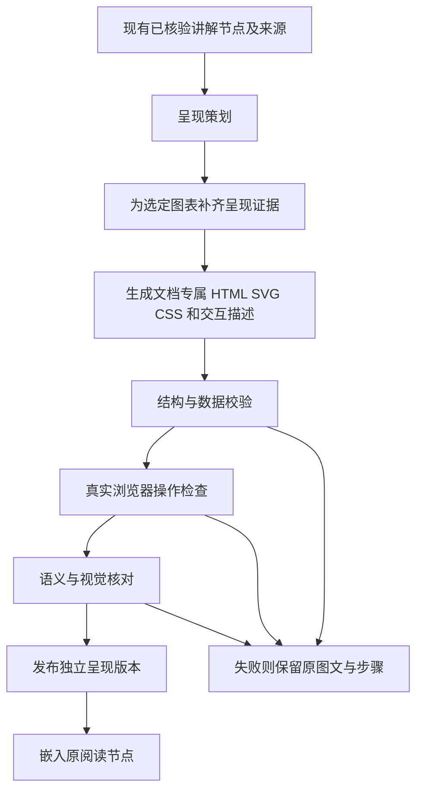

# paperMind 交互讲解呈现升级方案

日期：2026-10-25。独立链路、代表材料、十篇测试及集中修复已实施，现已在本地开启默认呈现：10篇发布27幅，3幅继续保留原图文，按用户最新指示先发布可用部分。下文的“当前实现”表格和目录示例保留方案提出时的基线；实际发布范围和未完成事项见PRESENTATION-RELEASE.md。

实现说明：实际产物位于data/presentation-runs/{job_id}/{node_id}/，使用独立presentations/presentation_jobs表。首版实现有限状态与原文数值绑定，未实现任意数学表达式或模型生成JS。旧规范正文和用户补充不由呈现任务写入。

## 1. 本轮目标与范围

将当前「连续讲解文字 + 文字步骤切换 + 原 PDF 页图」升级为与文档内容相适应的可探索讲解：操作能改变关系的显示、证据的组织或机制的展开，让用户看见文字不容易直接表达的东西。

“暂不做交互组件设计”在本方案中的执行含义：不建设通用业务组件库，不先罗列和开发一批固定模板，不要求模型在预设的组件类型里选一个。先生成每份文档专属的呈现，再根据真实使用结果考虑复用。必要的嵌入、状态更新、引用桥接是呈现运行基础，不是学科组件产品化。

改动限定为两部分：交互讲解的呈现生成，以及中间阅读区如何展示生成结果。以下业务行为保持原样：

- 论文的完整主线、原节点顺序、节点 ID、已核验正文和原文事实。
- Copilot 的连续对话、原有提问范围、步骤动作和执行回执。
- 右侧知识递归、个人概念库的显式保存与跨文档省略规则。
- 引用回查、原 PDF 阅读、区域提问和返回阅读位置。
- 页面补充的预览、应用、版本检查与撤回；已有补充不能被重生成覆盖。
- 上传、OCR、联网检索、原文事实核验和已有模型配置。

允许增加实现这些保持行为所需的内部适配代码，但不改变它们的 API 语义，不新增默认联网、知识库写入、能力推断或自动页面补充。

## 2. 当前实现的实际缺口

依据当前源文件，而不是初版设计草案：

| 位置 | 当前行为 | 本轮需要解决的问题 |
|---|---|---|
| backend/live_contracts.py / LessonNode | interaction 只有 none / stepper | 不能描述专属图解和多种探索路径 |
| backend/jobs.py | 从全文计划生成段落、概念、公式和文字步骤 | 缺少先判断“什么值得看见、怎样操作”的呈现策划 |
| frontend/src/LiveReading.tsx / LiveSteps | 切换当前步骤的标题和文字 | 操作尚未与图中的结构、路径和条件同步 |
| frontend/src/LiveReading.tsx / VisualFigure | 展示整页图片和视觉模型解释 | 没有将可信数据转成可筛选视图，也没有图内关系展开 |
| frontend/src/App.tsx | 同一种节标题、摘要、段落布局贯穿各文档 | 论文和研报的呈现差异小，正文、图解、细节层次不足 |

旧教学 Demo 的候选空间演示不作为真实论文自动生成能力的证据。本轮验证必须使用实际文档生成的产物。

## 3. 与 pdf-to-interactive-web 的关系

参考基线：仓库提交 f6e651e6f1e9f49836117f0067382aed4f67ea86，已在本次对话核对。该仓库提供 Skill、读法、页面契约和检查脚本，不提供现成的产品后端或交互运行引擎。

| 借鉴 | paperMind 的调整 |
|---|---|
| 内容先行、先判断读法 | 判断每个论证环节的呈现意图，而不是整篇只用一种模板 |
| 原句与转述对应的事实账本 | 复用现有 source / claim / 原页锚点，不重建另一套来源编号 |
| 首屏快速建立全貌 | 用短结论和可定位的全篇关系图；保留现有完整主线 |
| 操作帮助理解 | 每项操作写清要揭示的关系与真实变化，不以按钮数量验收 |
| 单文件页面的表现自由 | 生成每篇文档专属 HTML / SVG / CSS，嵌入现有阅读工作台 |
| 自检与原文抽查 | 事实、显示状态、实际操作分别验收，不用字符串命中证明交互有效 |

不继承：先猜再看、三题自测、最多7场景、默认2500字、超过30页只选一节、每篇必须2–4幅插画、整篇必须打包成独立网页。也不引入新的风格选择流程或改变三栏工作台。

## 4. 用户看到的呈现

阅读仍是一条可以从头读到尾的主线。章节题目、一句话要点和必要结论始终可见；交互帮助深入和比较，不把关键结论锁在必须完成的操作之后。

全篇入口：题目与短结论下面放一幅可定位的关系图。论文通常是问题—机制—证据—结论，研报可能是总量—结构—应用—边界，理论论文可能是前提—推导—结论。图由实际节点关系生成，点击回到既有 node_id，不额外制造一套目录。

每节：保留现有标题、摘要、正文；在相关文字旁或其后嵌入专属可探索图解。默认不渲染第二份与正文逐字重复的长说明。图内文字主要解释状态变化、对应关系和条件，原有深入讲解继续承担连续阅读。

丰富度来自内容组织与操作结果，包括结构联动、证据比较、局部放大、分层展开和条件变化，不要求每节都有动画。不承诺所有内容都能做数值实验。

### 4.1 第一批应实现的实际效果

以下是验收案例，不是待建设的通用组件目录：

| 真实材料 | 文档专属呈现 | 操作后的可观察变化 | 真实性边界 |
|---|---|---|---|
| Attention | 编码器—解码器结构图、信息流与掩码图 | 点选一条路径时突出对应层和正文；切换既有步骤时图中路径同步变化；查看掩码允许/禁止的位置 | 架构与机制来自原文；小矩阵数值若为教学示意须明确标注，不冒充训练结果 |
| CNNIC55 | 核心指标概览、城乡/年龄结构对照、原图与数据说明 | 切换同口径维度后真正改变图形和读数；点击指标展开单位、统计时点与来源 | 只展示实际取证数据；11.08亿的约数与110833万人的图中值分开标示；不补插缺失年份 |
| Simulation Argument | 前提—推理—结论关系图 | 点选命题展开它依赖的前提，突出相应推理边；查看作者未排除的其他分支 | 不把至少一个命题为真改成互斥穷尽，不加入虚构实验数据 |

不能可靠抽取数值时，使用原图热点、局部放大和相关段落联动，不以估读数字重绘精确曲线。图上没有数据点就不能生成悬浮“精确读数”。

### 4.2 学术内容的表达规则

- 优先说明“这个操作让哪种关系变得清楚”，再选择视觉表现。
- 保留原文术语、变量、条件、例外和不确定性；不为图形对称而补造论证。
- 原文事实、确定性换算、教学示意分别标记。单位换算保留有效位数及约数属性。
- 需要原文之外的知识时，使用现有知识侧栏和 Copilot；本轮呈现生成不另行扩展知识范围。
- 不从用户的点击、展开与停留推断掌握状态，不改变概念库。
- 与条件有关的分支可以展开，结论仍应能在默认主线读到；用户不需要“操作完”才算完成阅读。

## 5. 技术路线：文档专属呈现，沿用既有阅读宿主

推荐生成 HTML / SVG / CSS 和声明式交互描述；由一段受信运行脚本执行状态更新。第一版不让模型输出任意可执行 JavaScript，也不建立固定业务组件类型列表。

模型可自由决定结构图的布局、视觉层级、标注、对照形式和阅读节奏；运行器只提供通用的选中、展开、切换、过滤、高亮和受限数值绑定。这些是 DOM 状态操作，不是“通信组件”“论文组件”等学科模板。



采用节点内嵌，而不是把整篇文档搬入一个大 iframe。这样保留父页面的目录定位、阅读滚动、概念入口、补充内容和每节提问；某节呈现失败也不影响全篇。

### 5.1 为什么暂不直接生成任意 HTML / JS

自由生成整页程序会让代码重建来源弹层、对话入口和阅读状态，容易出现两套行为，也难以保证补充内容的版本与撤回。纯固定模板又会限制本次需要的文档差异。

本方案把表现自由放在 HTML / SVG / CSS，把执行限定在可验证的声明式操作。以后确有机制无法表达时，再评估独立代码沙箱，不在本轮提前扩展。

## 6. Agent、Skill 与模型分工

保留原生成、核验、检索与对话链路。新增的是呈现阶段任务，不增加一个能自主访问任意工具的总 Agent。

| 阶段 | 输入 | 输出 | 默认模型/执行者 |
|---|---|---|---|
| 呈现策划 | 现有 plan、node、claim、source 和文档关系 | 需要表达的关系、用户动作、默认结论、证据需求、降级方式 | qwen3.5-plus |
| 呈现证据准备 | 策划指向的图/表/页码与原句 | 带来源的数据、图内标注、单位/时点/条件，或明确不可读 | 确定性代码；必要时 qwen3-vl-plus |
| 场景编写 | 策划、已核验正文、证据、视觉约束 | HTML/SVG、CSS、声明式状态/绑定、事实标记和检查路径 | qwen3.5-plus |
| 结构检查 | 完整产物 | 引用、DOM、状态、数据与资源依赖检查 | 确定性代码 |
| 浏览器检查 | 实际渲染产物 | 默认与交互后截图、状态变化、错误及窄屏结果 | Playwright / Edge |
| 内容复核 | 实际显示文案、关键状态截图、原始证据 | supported / insufficient / contradicted，具体问题 | qwen-plus；图像问题用 qwen3-vl-plus |

建议新增三个应用内部任务规范：presentation-plan、presentation-author、presentation-review。它们不替换 knowledge-expansion、copilot-orchestrator 等规范；原 interactive-lesson 在本轮仍负责正文与现有步骤。

每个策划项必须回答：

1. 哪段关系光看文字不易理解？
2. 用户可以做什么？
3. 操作后图形、证据或关系具体怎样变化？
4. 什么依据支持默认状态和其他状态？
5. 即使用户不操作，仍必须读到什么结论？

不用交互类型枚举预先限制策划，不按学科名称硬套模板。不符合这些条件的装饰性动效不生成。

### 6.1 图表证据的局部补齐

现有默认2页视觉预读不能视为全篇图表取证完成。本轮不全量提高旧解析器预算，也不改 OCR 和检索的现有规则。

呈现策划若要使用某页图表，新增阶段仅为该呈现读取指定原页/区域。数据记录至少含 value_text、normalized_value、unit、period、population、precision、source_id、page、bbox 与抽取状态。缺失维度或不同统计口径不能用一个“可切换维度”控件拼成同一序列。

同一原图、原句与数据冲突时阻止精确重绘；保留原图和差异说明。只因图形漂亮而改变坐标轴基线、截断范围或误差表达也需要复核。

## 7. 独立产物与存储契约

不把新 HTML 塞入原 paragraphs，也不重写现有 LessonNode 的业务含义。增加独立 PresentationManifest；它描述产物的身份、来源、验证与状态，不是组件库配置。

```json
{
  "id": "presentation-example",
  "document_id": "pdf-example",
  "node_id": "existing-node-id",
  "base_node_hash": "sha256-of-canonical-node-and-source-quotes",
  "presentation_revision": 1,
  "status": "draft",
  "purpose": "展示某项机制中的信息路径与约束",
  "source_ids": ["existing-source-id"],
  "claim_ids": ["existing-claim-id"],
  "artifact": {
    "html": "scene.html",
    "css": "scene.css",
    "behavior": "behavior.json"
  },
  "checks": {
    "structure": "pending",
    "data": "pending",
    "browser": "pending",
    "fidelity": "pending"
  },
  "fallback": "existing_node"
}
```

behavior.json 记录可访问控件、状态字段、有限的状态变更和绑定目标。支持哪些基础操作由运行器白名单规定；不接受字符串代码、任意函数名、网络地址或 eval。数值绑定采用有限数学表达式语法和单位检查，不执行模型写的脚本。

初步文件结构：

```text
data/presentations/{document_id}/{node_id}/{presentation_revision}/
  plan.json
  evidence.json
  scene.html
  scene.css
  behavior.json
  manifest.json
  checks.json
  screenshots/
```

SQLite 新增 presentations、presentation_jobs 两张独立表，不替换 documents、jobs、messages、patches、library、memories 的既有语义。旧文档可单独补生成呈现，不需要重跑论文解释、重新 OCR 全文或改动用户补充。

base_node_hash 包含规范正文、步骤、公式、主张及引用原句哈希，排除对话历史、概念库与用户补充。重新生成正文后，旧呈现必须标 stale，不能继续显示成与新正文匹配；仅新增用户补充不使规范节点呈现失效。

## 8. 前端嵌入及兼容方式

新增 PresentationFrame，在既有 reading-section 内展示产物。标题、摘要、正文、来源按钮、概念入口和用户补充仍由原 React 页面拥有。

iframe 使用不含 allow-same-origin 的 sandbox，只运行受信的呈现运行器。HTML/SVG 先清理，拒绝 script、事件属性、外链、表单提交、嵌套页面、外部样式和动态资源。CSP 禁止网络资源、eval、弹窗及其他非必要能力。iframe 仅接收该节点所需的有限证据和样式令牌，不接收密钥、对话库或概念库。

可信运行器以受控资源或哈希脚本交付；代码生成部分不包含 JS。不能把“iframe存在”或“源码没出现fetch”当作隔离验证，必须实际测试资源请求、导航及越界消息。

只保留有限宿主消息：

| 场景意图 | 宿主处理 | 不改变的业务 |
|---|---|---|
| 点击来源 | 调用现有 cite(source_id) | 原句/原PDF回查 |
| 点击已存在的概念 | 调用现有 concept(concept_id) | 右栏递归与显式保存 |
| 跳转论证节点 | 调用现有 navigate(node_id) | 目录与阅读锚点 |
| 选中图内文字提问 | 将文本交给现有选区/提问入口 | 用户仍需发送；不自动发消息 |
| 内容高度变化 | 宿主校验后调整高度 | 仍由主阅读区滚动 |

每条消息检查 iframe.contentWindow、通道令牌、文档/节点身份、类型与长度；来源/概念/节点必须在当前宿主允许集合内。由于隔离 iframe 的 origin 可能为 null，不能仅检查 origin 字符串。

现有 Copilot 的 next_step / previous_step / reset_steps 保持原规则和执行回执。对带有既有 steps 的节点，由宿主将原 stepStates 镜像给呈现，图解响应同一状态；非步骤探索不冒充已有步骤动作，也不新增 Copilot 工具。

图内新出现但未登记的概念不自动写入侧栏或概念库，可作为选区提交给既有 Copilot。用户应用的页面补充继续显示在宿主原位置，不放入 iframe，也不随呈现重试丢失。

### 8.1 滚动、性能和无障碍

- 父阅读区保持唯一连续滚动；避免多个纵向 iframe 内滚动条。
- 场景高度有上限，内容过长优先分层展开；尺寸事件限频，防止滚动跳动。
- 近视口加载，离开视口暂停非必要运动；切换原PDF时保留原有返回位置。
- 提供键盘访问、可见焦点、文字标签和减弱动画；不只用颜色表示关系。
- 拖动必须有点击/键盘等价路径；手机交互不能靠悬停完成。
- 窄屏允许图的受控横向探索，但页面正文和主要按钮不得横向溢出。
- 所有数值图保留可读表格/文字；图像识别不充分时仍能查看原图。

## 9. API 与任务集成

新增独立接口，下面路径是本轮提案，不是当前已有接口：

```text
POST /api/documents/{id}/presentations/generation
GET  /api/documents/{id}/presentations
GET  /api/presentation-jobs/{id}
POST /api/presentation-jobs/{id}/cancel
GET  /api/presentations/{id}/artifact
```

旧 API 不移除、不重命名。已有完整文档通过独立任务补生成；新文档在原正文核验完成后，自动进入呈现阶段。任务取消保留可用正文和已发布呈现。

文档 ready 保持原有的事实/覆盖含义，呈现使用独立状态。生成期间保留原图文；单节呈现失败时回退原节点，不把可靠正文变成错误页面。不得把已有 ready 当成新呈现也已通过的证据。

为满足首轮完整主线，不能要求用户点 Copilot 才补齐可视化解释中缺失的核心文字。呈现任务可异步完成，但未完成时应如实显示图文版本，不声称完整交互呈现已经发布。

## 10. 文件改动边界

| 新增/修改 | 计划职责 |
|---|---|
| backend/presentation_contracts.py | 独立策划、产物、证据与检查契约 |
| backend/presentation_jobs.py | 呈现任务、阶段产物、取消、有限失败处理 |
| backend/presentation_validation.py | 数据、DOM、状态、来源、依赖检查 |
| backend/presentation_routes.py | 新增呈现接口，不改现有聊天/概念/patch接口 |
| agents/skills/presentation-*/ | 按阶段加载的呈现规范 |
| frontend/src/PresentationFrame.tsx | 嵌入、桥接、尺寸与降级 |
| frontend/src/presentation/scene-runtime.* | 受信通用状态运行器，不含学科组件目录 |
| frontend/src/App.tsx | 在现有节点增加呈现槽、转发现有回调 |
| backend/store.py | 仅新增两张独立表 |
| backend/main.py | 挂载新增路由和启动呈现任务 |
| backend/jobs.py | 原正文完成后的可选任务衔接，不改原事实/覆盖判定 |
| scripts/tests | 新增呈现验收，保留所有原功能回归 |

backend/live_copilot.py、retrieval.py、parser.py 及原知识和页面补充的核心逻辑不作为本轮重构对象。必要的原页读取沿用现有能力，由新增呈现证据阶段调用。

## 11. 验收：分别证明可读、可信、可操作

| 维度 | 必须有的证据 | 不能冒充通过的情况 |
|---|---|---|
| 内容覆盖 | 默认主线仍包含核心机制/论证、结论和边界 | 图好看但关键结论只能操作后偶然发现 |
| 原文忠实 | 图中文字、各状态数字/标签、条件有对应原句或原图 | 只查初始页面，不查切换状态 |
| 操作有效 | 浏览器操作前后，相关图形/数据/关系实际改变 | 按钮只改了描述文字或增加装饰动画 |
| 交互有用 | 操作对应清晰的比较、约束、推理或机制目标 | 用按钮数量、动画数量评分 |
| 稳定性 | 控件可重置，状态可预测，无运行错误；失败回退正确 | 仅截图显示控件存在 |
| 隔离与资源 | 实际资源请求、导航和消息边界测试 | 静态关键词检查替代运行验证 |
| 兼容 | 原文回查、右栏、对话、步骤回执、概念库、patch回归 | 为了新页面重写或绕开原功能 |
| 响应式 | 1440/1024/736/390/320实际操作与截图 | 仅构建通过或页面不溢出 |

候选验收例：Attention 点选编码器/解码器能看到不同路径，原掩码不能被展示成全连接；CNNIC 切换城乡维度后数据与口径一起更新，禁止混用不同统计时点；哲学命题选择只改变依赖关系展示，不能把不互斥命题强制做成单选。

交互状态采用有限图或有限枚举，列出所有可到达状态；连续参数测试边界值、中间值及不变量。极端值和不可达状态不能仅交给模型判断。数值/标签绑定尽量由受信运行器从证据值填入，减少模型在多份图里手写同一数字。

本轮继续使用既有10篇测试语料。每批测试固定代码、提示词和产物版本，先跑完整批次，记录失败、截图和来源，再集中修复；复测另存，不覆盖首轮记录。不得把 supported 的拒答当作成功生成，也不把呈现生成完成等同于交互学习效果已验证。

## 12. 实施顺序与交付物

### 阶段A：独立呈现链路

完成产物契约、存储、受信运行器、隔离与宿主桥接。用一份已核验真实节点产物验证来源、概念、选区、步骤和降级。交付真实内容的嵌入样本、桥接测试、隔离检查，不以业务组件库为交付物。

### 阶段B：三篇代表材料

为 Attention、CNNIC55、Simulation Argument 运行完整策划—生成—检查，分别形成机制、数据、论证三种实际呈现。先跑完三篇并记录问题，再集中修复。保留每篇选择了什么关系、哪些没有交互以及原因。

### 阶段C：十篇跨领域回归

扩展到原10篇。评价按内容适配、来源正确、真实状态变化和原功能不退化，不规定所有论文的交互数量或同一视觉骨架。完成全批测试后再做集中修复与定向复测。

### 阶段D：发布为讲解默认呈现

仅发布通过检查且 base_node_hash 匹配的版本。已有图文保留为内容与故障回退。提供生成记录、失败原因和回退状态；用户无需迁移概念库、对话或页面补充。单篇呈现重新生成只影响呈现版本。

本轮完成定义：真实材料形成内容适配的丰富交互，默认主线仍完整，关键操作有可观察结果和可信依据，原功能回归通过。通用组件库、任意代码执行、全产品重构、理解测验和掌握评分不进入本轮。

## 13. 实施时的预算与已知取舍

呈现将新增模型、指定图表取证和浏览器运行成本。先在代表材料测量实际调用/耗时，再设发布预算；不承诺未经实测的耗时或价格。

初步工程限制可从每节点独立产物、单次有限修复、明确文件大小和状态数上限开始；最终数值由阶段B实测确定。只重试失败场景，不重新生成全文。有限修复也保留修复前产物，不能抹掉失败记录。

声明式交互第一版不覆盖复杂物理仿真、完整训练流程和自由三维程序。遇到无法忠实表达的机制，优先给结构关系、状态展开或原图联动，不声称已复现算法。若后续确需任意代码，应单列方案与验证边界，而不是在本轮悄悄放开。

## 14. 参考与现有依据

- https://github.com/ai-azhou/pdf-to-interactive-web/tree/f6e651e6f1e9f49836117f0067382aed4f67ea86
- docs/REFERENCE-PROJECT-ANALYSIS.md：参考项目方法、限制与检查器实测。
- docs/CONFIRMED-DESIGN.md：已确认的29项产品行为。
- docs/LIVE-BOUNDARY-REPORT.md、docs/FIRST-PASS-ISSUES.md：现有真实模型生成和跨领域测试边界。
- backend/live_contracts.py、backend/jobs.py、frontend/src/LiveReading.tsx、frontend/src/App.tsx：本轮改进的实际代码基线。
